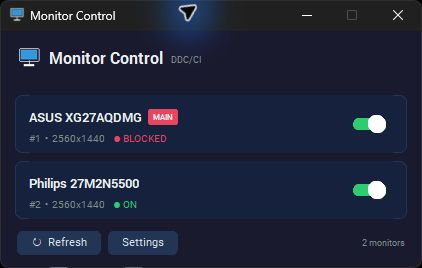

# Monitor Control

A small Windows tray utility to turn individual external monitors off and back on using DDC/CI.

**0.1.0 beta — a personal utility, shared for others to use.** Hardware compatibility varies.

[Download the Windows beta](https://github.com/viskradot/monitor-control/releases/tag/v0.1.0-beta.3)



## Features

- Compact window and tray controls, with main-monitor protection.
- Optional configurable global shortcut for one secondary monitor.
- Identity-based monitor targeting and automatic refresh after display changes and detected sleep/resume gaps.
- Background requests and cached names; no continuous DDC polling.
- Normal Quit restores monitors turned off by this application session, with bounded wake retries and ON readback.
- Local diagnostics; no telemetry or online account.

## Use

On Windows 10/11, enable **DDC/CI** in your external monitor's on-screen menu. Run `MonitorControl.exe` from a published release, or run from source below. Python is not needed for the EXE.

Use a monitor's switch or its tray entry. The main monitor is always **BLOCKED**. In **Settings**, select a secondary monitor, click the shortcut field and press a combination such as `Ctrl+Alt+M`, then click Save. The shortcut is disabled initially; use Clear and Save to disable it again. Conflicting combinations are rejected.

Closing the window hides it to the tray. **Quit** restores monitors this session successfully turned off, then exits. If restoration cannot be confirmed, choose Retry, Quit anyway, or Cancel to keep running.

| Status | Meaning |
|---|---|
| ON / OFF | Last successful power-state reading; not continuously monitored. |
| ON/OFF (REQUESTED) | Last accepted command; physical state has not been confirmed. Retained when readback fails. |
| TURNING ON / TURNING OFF | A command is in progress; duplicate commands are blocked. |
| UNKNOWN | No reliable state is available. Failed reads never imply ON. |
| BLOCKED / MAIN | The main display cannot be turned off by this utility. |

ON commands are retried briefly and confirmed through DDC readback. Use Refresh to check physical-button changes; opening the window also refreshes state.

## Limitations

- Some monitors, cables, docks, drivers and adapters do not support reliable DDC/CI. Built-in laptop panels generally cannot be powered through this interface.
- Some displays stop accepting commands in standby and need their physical power button. Wakeup cannot be guaranteed on every monitor.
- Crashes, Task Manager termination, power loss and forced OS shutdown can bypass restoration. Keep access to the power button.
- If a display disappears from Windows after OFF, the app will not guess another target. Reconnect it or use its physical controls.
- Moving ports may change a saved monitor identity; reselect the shortcut target if unavailable. Ambiguous/cloned physical targets are refused.
- This app does not disable displays in Windows or rearrange the desktop. Other DDC utilities may interfere; test with them closed.

## Run and build

Requires Windows and Python 3.12+:

```powershell
python -m pip install -r requirements.txt
python main.py
```

Tests do not change physical monitor power:

```powershell
python -m unittest -v
```

Build with `build.bat`; output is `dist/MonitorControl.exe`. The Windows workflow tests Python 3.12 and 3.14 and prepares an artifact on pushes/manual runs. It does not publish releases automatically.

## Troubleshooting

Use **Settings → Copy diagnostics** when reporting a problem. Include monitor model, GPU/driver, connection type and whether physical-button wakeup works. Review diagnostics before posting publicly.

Settings, cache and a bounded log live in `%LOCALAPPDATA%\MonitorControl`. Logs can contain Windows display identifiers; share them only if you choose.

See [configuration](docs/CONFIGURATION.md), [DDC/CI](docs/DDC-CI.md), [architecture](docs/ARCHITECTURE.md) and [building](docs/BUILD.md).

## Contributions and support

This is a personal utility shared for others to use. Issues and pull requests are welcome, but support, reviews, and merging are not guaranteed. Changes are accepted at the maintainer's discretion. See [CONTRIBUTING.md](CONTRIBUTING.md).

## License

Application source: [MIT](LICENSE). Dependencies retain their own licenses; see [third-party notices](THIRD_PARTY_NOTICES.md).
